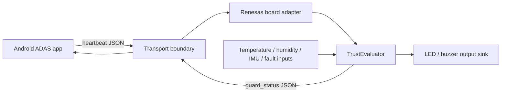

# Renesas ADAS Guard

Renesas ADAS Guard is a portable trust and health-monitoring layer for an Android advanced driver-assistance system (ADAS) paired with a board-side controller. It turns heartbeat freshness, environmental readings, mount stability, and sensor-fault signals into a deterministic `trusted`, `degraded`, or `untrusted` decision.

The repository is intentionally split into a dependency-free reference implementation and a board-neutral integration seam:

- `core/` contains the Python reference evaluator and unit tests.
- `integration/` contains the versioned JSON protocol, Android/Kotlin transport models, and a C++17 evaluator with a host demo.

The Android application and a Renesas SDK project are not included here. The integration files are designed to be copied into an existing Android app and adapted to the selected Renesas board.

> **Safety disclaimer:** This is a development and demonstration scaffold, not a production automotive safety system. It has not been qualified, safety-certified, security-audited, or validated for use while driving. Never use it as the sole basis for vehicle control, braking, steering, or other safety-critical decisions.

## Project status

This repository provides:

- deterministic Python and C++ trust evaluation with matching thresholds and reason precedence;
- heartbeat expiry and sensor-fault fail-safe handling;
- thermal, fog-risk, mount-tilt, and vibration warnings;
- degraded-state recovery hysteresis;
- a versioned JSON heartbeat/status contract;
- a host-side C++ demo that exercises healthy, degraded, and untrusted states;
- a dependency-free scripted Python simulator covering normal, hot, fog, tilt, vibration, sensor-fault, and heartbeat-loss states;
- lifecycle-neutral Kotlin models and a `StateFlow` controller for Android integration.
- a Makefile and GitHub Actions workflow that run the same reproducible checks locally and in CI.

It does **not** provide a complete Android app, board support package, vehicle network integration, production actuator drivers, authentication, encryption, or a vehicle safety case.

## Quickstart

### Prerequisites

- Python 3.8 or newer for the reference evaluator and tests;
- a C++17 compiler such as `g++` or `clang++` for the host demo;
- Kotlin, Android Gradle Plugin, `kotlinx.serialization`, and coroutines only when integrating the Kotlin files into an Android project.

No third-party Python packages are required.

### Run the Python tests

From the repository root:

```bash
python3 -m unittest discover -s core/tests -p 'test*.py' -v
```

On Windows PowerShell, use `python` instead of `python3` if that is the installed command.

If the checkout is used as a package from outside its root, set `PYTHONPATH=.`
before running module commands.

### Run the scripted scenario simulator

From the repository root:

```bash
PYTHONPATH=. python3 -m core.scenario_runner --scenario scenarios/demo.json
```

Use `--json` to emit one protocol-compatible `guard_status` frame per step.
The runner accepts a JSON object with a non-empty `steps` list (or a bare step
array); set `heartbeat_at_s` to `null` to exercise a missing heartbeat.

### Build and run the C++ demo

From the repository root:

```bash
mkdir -p build
g++ -std=c++17 -Wall -Wextra -Wpedantic -Werror \
  integration/GuardEvaluator.cpp integration/main.cpp \
  -o build/guard_demo
./build/guard_demo
```

The demo exits with status `0` after checking healthy, thermal-warning, fog-warning, mount-tilt, heartbeat-expiry, and sensor-fault-precedence paths. Its output includes protocol-shaped JSON status messages and local LED/buzzer transitions.

### Optional Python smoke check

```bash
python3 -m compileall -q core
```

### One-command local check

The repository includes a small `Makefile` so local checks and CI use the same
commands:

```bash
make check
```

This runs the Python tests, Python syntax compilation, the warning-clean C++
build/demo, and the scripted scenario simulator.

## Architecture



### Evaluation model

Each synchronized sample is evaluated using the following default policy:

| Condition | Default threshold | Effect |
| --- | ---: | --- |
| Heartbeat age | greater than `1.0 s`, or no heartbeat | score `0`, `untrusted` |
| Sensor fault | any reported fault or invalid C++ input | score `0`, `untrusted` |
| Ambient temperature | `>= 80.0 °C` | `-20` points |
| Dew-point margin | `< 2.0 °C` | `-25` points, fog risk |
| Absolute mount tilt | `> 5.0°` | `-25` points |
| Vibration RMS | `> 0.8 g` | `-20` points |

The score starts at `100`. Warning conditions enter `degraded` at `80` or below. A previous `degraded` state remains degraded until the score reaches `90`, which prevents rapid state flapping. Heartbeat expiry and sensor faults always take precedence and force `untrusted`.

Reason codes are emitted in a stable order:

1. `heartbeat_expired`
2. `sensor_fault`
3. `thermal_warning`
4. `fog_risk`
5. `mount_tilt`
6. `vibration`

The Python and C++ implementations are intended to produce the same policy result for equivalent inputs. The Python evaluator validates its typed inputs before evaluation; the C++ evaluator converts invalid numeric input into a sensor fault and keeps wire telemetry finite.

## Repository layout

```text
core/
  evaluator.py                 Python trust evaluator
  models.py                    Typed inputs, limits, and decisions
  protocol.py                  Dependency-free JSON wire serialization
  scenario_runner.py           Scripted CLI simulator
  tests/test_trust_evaluator.py
  tests/test_protocol_and_scenarios.py
scenarios/
  demo.json                    Seven-state simulator script
integration/
  guard-protocol.md            JSON message contract and policy
  ANDROID_WIRING.md            Exact Android-side integration steps
  RENESAS_PORTING.md           Board adapter and validation checklist
  GuardModels.kt               Kotlin serializable messages
  GuardProtocol.kt             Kotlin codec and validation
  GuardController.kt           Android StateFlow controller
  GuardEvaluator.h/.cpp        C++17 evaluator and output boundary
  main.cpp                     Host smoke-test demo
.github/
  workflows/ci.yml             Python and C++ checks
  ISSUE_TEMPLATE/              Concise bug-report template
  pull_request_template.md     Review checklist
```

## Protocol and demo output

`integration/guard-protocol.md` defines protocol version `1.0` and two message types:

- `heartbeat`: sent by the Android side to prove liveness;
- `guard_status`: emitted by the board-side evaluator with state, score, reasons, telemetry, and output commands.

The C++ demo emits examples such as:

```json
{"protocol":"1.0","type":"guard_status","state":"trusted","score":100}
```

The complete payload includes sequence numbers, timestamps, heartbeat age, dew-point margin, reason codes, and `outputs`. JSON framing, authentication, encryption, retry behavior, and clock synchronization are deliberately left to the transport integration.

## Android integration

Copy these files into a package path matching the existing app, for example:

```text
app/src/main/java/com/example/adas/integration/
  GuardModels.kt
  GuardProtocol.kt
  GuardController.kt
```

The existing app owns its lifecycle, coroutine scope, scheduling, and transport:

1. Construct one `GuardController` in the app's state owner.
2. Call `publishHeartbeat()` from an existing periodic task (the reference cadence is 250 ms).
3. Send the returned encoded payload through the board transport.
4. Pass each board `guard_status` payload to `receiveGuardStatus()` or `receive()`.
5. Collect `status` as a `StateFlow<GuardStatus>` and render the trust state in the UI.
6. Treat `DEGRADED` as a signal to apply an explicitly designed fallback policy and `UNTRUSTED` as a blocking warning in the demo UI.

The Kotlin files require the Android project's existing `kotlinx.serialization` and `kotlinx.coroutines` setup. Do not route the physical alarm through Android: the board-side output sink is the independent fallback path.

## Hardware integration checklist

The exact Renesas board and SDK are intentionally unspecified. Before connecting this scaffold to hardware:

1. **Select and document the target.** Record the Renesas family, board revision, SDK/toolchain version, clock source, memory constraints, and supported temperature/IMU peripherals.
2. **Implement input adapters.** Convert sensor readings into `GuardInput` with explicit units: Celsius, relative humidity percent, degrees, and vibration RMS in `g`. Reject missing, stale, out-of-range, or non-finite values as sensor faults.
3. **Implement heartbeat transport.** Carry the versioned JSON contract over the selected BLE, serial, CAN gateway, or other transport. Define framing, timeouts, sequence handling, clock assumptions, and recovery behavior.
4. **Implement the output sink.** Replace `LocalLedBuzzerOutput` with a board adapter that maps `setLed()` and `setBuzzer()` to GPIO, RGB LED, HMI, or audio drivers. Verify the power-on and communication-loss states.
5. **Add the hardware watchdog.** Use the board's watchdog independently of the evaluator, with a documented policy for task stalls, sensor-bus failures, and transport loss.
6. **Exercise fault injection.** Test heartbeat removal, stale sequence numbers, invalid JSON, sensor disconnection, NaN/out-of-range readings, thermal limits, fog-risk conditions, tilt, vibration, reset, and power cycling.
7. **Validate at system level.** Compare Python reference results with the C++ target, measure timing and resource use, review actuator behavior, and complete the required automotive safety, cybersecurity, and regulatory engineering process before any real-vehicle use.

## Limitations and non-goals

- Thresholds are illustrative defaults and must be derived, reviewed, and validated for the target system.
- The protocol does not define authentication, encryption, replay protection, message framing, retry, or clock synchronization.
- The evaluator does not prove camera quality, neural-network correctness, object-detection performance, or vehicle-state correctness.
- No claim is made about ISO 26262, ISO/SAE 21434, ASPICE, UNECE, or any other compliance status.
- This code must not be used as the sole safety mechanism or connected directly to vehicle actuation without a qualified engineering and safety process.

## Contributing

See [CONTRIBUTING.md](CONTRIBUTING.md) for setup, style, testing, and pull-request expectations. See [SECURITY.md](SECURITY.md) for private vulnerability reporting guidance.

## License

Code in this repository is released under the [MIT License](LICENSE), unless a file states otherwise. The license permits reuse, modification, and distribution with the required copyright and license notice. Safety, regulatory, and fitness-for-purpose obligations remain with the integrator.
